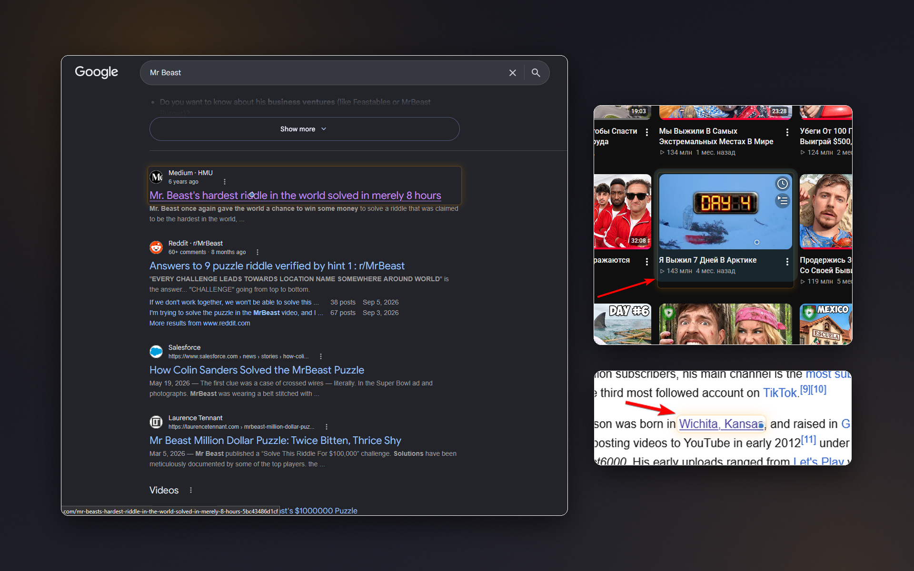
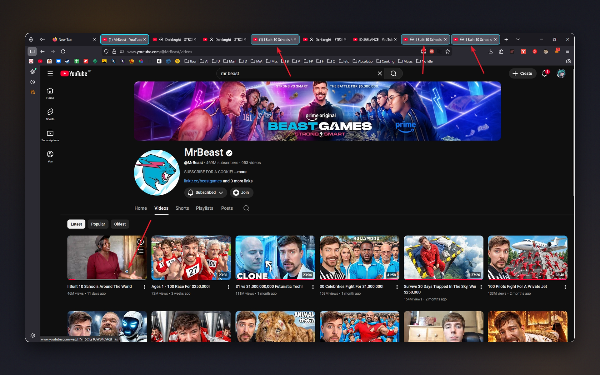
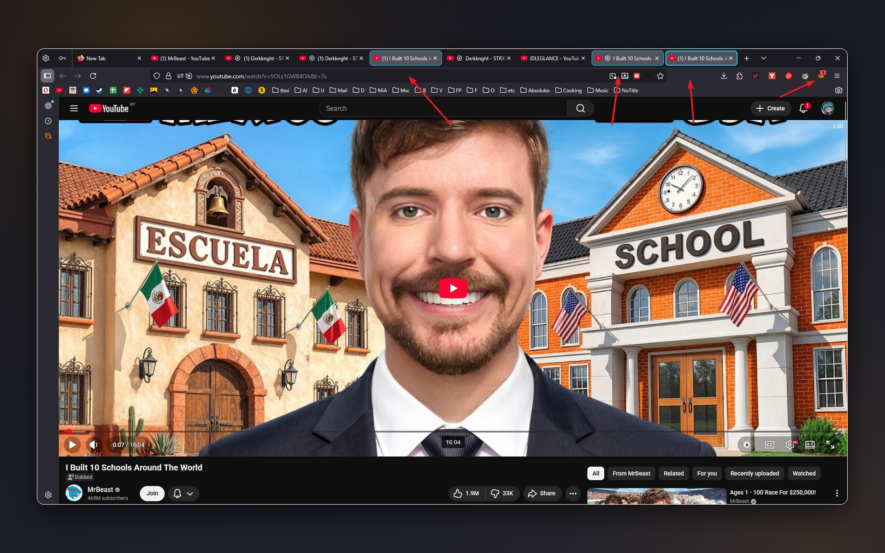
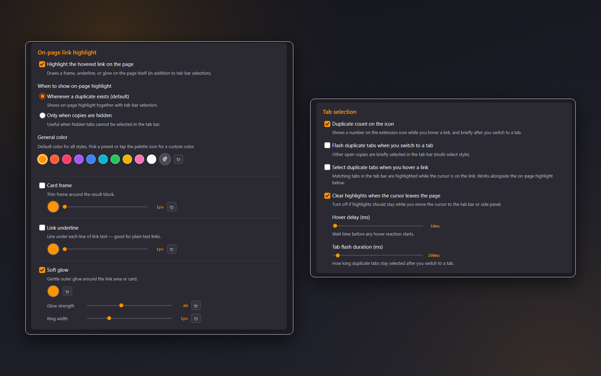

# Highlight Opened Tabs

See which pages are already open: hover a link to highlight matching tabs, spot duplicates of the active tab, and mark the link itself with a frame, underline or glow in your own colors.

**[Install from addons.mozilla.org](https://addons.mozilla.org/firefox/addon/highlight-opened-tabs/)**

## Screenshots

| | |
|:---:|:---:|
|  Links that are already open in another tab are marked right on the page – with a card frame, an underline, or a soft glow. |  Hover a link and every open tab with the same address is highlighted in the tab bar. |
|  Duplicates of the active tab are highlighted, and the badge on the toolbar icon shows how many copies are open. |  Pick highlight styles and colors, adjust thickness, glow strength, hover delay and flash duration, and choose how tabs are selected. |

## Features
- **Highlight opened tabs on hover** – hover any link and tabs with the same URL are selected in your tab strip. The hover delay is adjustable, and highlights can be cleared when the cursor leaves the page or kept while you move to the tab bar or side panel.
- **On-page link highlight** – when the hovered link is already open, it's marked right on the page. Combine any of three styles:
  - **Card frame** – a thin frame around the result block, with adjustable border width
  - **Link underline** – a line under each line of link text, with adjustable thickness
  - **Soft glow** – a gentle outer glow, with adjustable strength and ring width

  Pick a color from 10 presets or any custom color, override it per style, and reset any setting in one click. Show the highlight whenever a duplicate exists, or only when the matching tabs are hidden (handy with [Workspaces](https://github.com/Kustrica/Workspaces)).
- **Duplicates of the active tab** – other tabs with the same normalized URL briefly flash, and an optional badge shows how many copies are open. Matching ignores `www.`, trailing slashes, parameter order and tracking parameters (utm_*, fbclid, gclid…), and treats youtube.com and youtu.be links to the same video as one.
- **Site access under your control** – if site access is off, a clear banner and a "!" on the icon offer one-click **Grant access**. You can also use the extension without page highlighting.
- **Language selection** – follow the browser language or pick any of the 19 interface languages.

## Technical details
- Manifest V3, lightweight content script, event-based background logic
- Settings stored locally: **no data collection**, tracking, or analytics

## Localization
Translated into **19 languages**: English, Spanish, German, French, Russian, Belarusian, Chinese (Simplified and Traditional), Japanese, Portuguese, Italian, Korean, Polish, Dutch, Turkish, Ukrainian, Indonesian, Arabic, and Vietnamese.

## Support
[Telegram](https://t.me/kustric) · [Ko-fi](https://ko-fi.com/kustrica) · [Patreon](https://www.patreon.com/kustrica) · [Boosty](https://boosty.to/kustrica)
